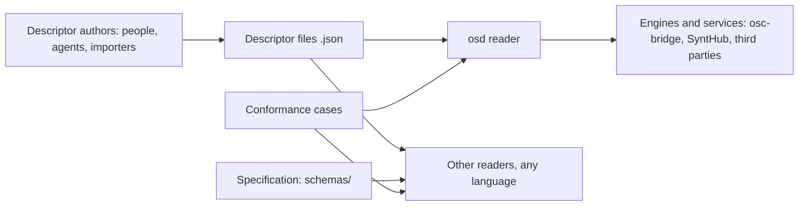
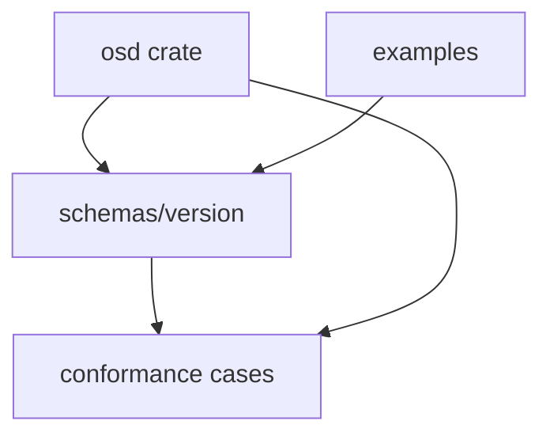

# Open Synth Descriptors — architecture

OSD is a format for describing music devices, their sounds, their firmwares and their recognition. This repository holds three parts that change together: the specification (JSON schemas, one folder per version), the conformance cases that give each field its meaning, and `osd`, the reference reader every Rust consumer uses. This document describes the target construction; the reader and the conformance cases are built by the first epic.

## 1. Context

What crosses the repository's edges:

- **descriptor files**, JSON documents that declare their version by `$schema`;
- **the published schemas**, one folder per version, served at a stable URL per version;
- **the conformance cases**, input descriptors with the result every reader must give;
- **the `osd` crate**, typed descriptors and resolution, for Rust consumers.

What the reader accepts and refuses lives in `osd/docs/CADRE.md`; what it exports in `osd/docs/INTERFACE.md`.

## 2. Strategy

1. **A version is a folder that never changes.** Each version of the format is a complete set of schemas under `schemas/<version>/`; a change of the format is a new folder with a converter from the previous one. Reason: a descriptor valid today stays readable, and a reader states the versions it reads.
2. **Meaning is written as cases, not only as shape.** A conformance case pairs an input (descriptors, and for resolution their linked files) with the result a reader must give; a field whose meaning no case shows is underspecified. Reason: two readers in two languages agree on what a descriptor means, as WebAssembly's reference interpreter and test suite make engines agree.
3. **Structure lives in JSON, never inside strings.** A value's encoding, a checksum, an address parameter is a JSON structure the schema checks. Reason: any tool understands a descriptor with a JSON Schema validator and no OSD code.
4. **Executable parts are declared capabilities.** A descriptor that needs a script (Lua) to recognise a device or recall a program declares the capability; a reader without it knows at load time what it cannot do. Reason: OSD stays readable by tools that run no code, and declarative fields are preferred whenever they can express the case.

5. **The format's identity is a permanent address.** From version 0.5, each schema's `$id` is `https://w3id.org/osd/<version>/<kind>.schema.json`, a permanent identifier kept by the W3C Permanent Identifier Community Group, which redirects to the schemas served by GitHub Pages from this repository; the format is also listed in the SchemaStore catalogue, so code editors complete OSD descriptors. Reason: the format's identity depends on no host, person or domain, and moving the hosting changes only the redirect.

## 3. Components

| Part | Responsibility | Owns | Langage |
|---|---|---|---|
| `schemas/<version>/` | the shape of each descriptor kind: device, profile, sound, fingerprint, firmware | the published JSON schemas | |
| conformance cases (`conformance/<version>/`) | the meaning: what a reader returns for each case, resolution included | input files and expected results | |
| `osd` (`osd/`, the Cargo workspace at the root) | read a descriptor strictly into types, resolve maker profiles and shared MIDI (`midi_of`), report declared capabilities, convert between versions | the Rust types of the format | cargo |
| `examples/` | one readable example per descriptor kind | example files | |

## 4. Data

| Data | Shape | Made by | Read by |
|---|---|---|---|
| descriptor | JSON with `$schema` naming its version | authors | every reader |
| resolved device | the device with its profiles and shared MIDI applied | `osd::resolve` | engines, exporters, services |
| conformance case | a folder: input descriptors, the expected result or the expected fault | the specification's authors | `osd` tests, other readers |

## 5. Flow

**A reader loads a device that shares another's MIDI.** `osd` parses the file strictly, asks its file source for the file named by `midi_of` and for each maker profile named, merges them by the rules the cases fix (the file's own keys win, a `null` removes a profile's key, depth at most 8, cycles refused), and returns the resolved device with the capabilities it declares.

## 6. Runtime

`osd` performs no I/O: its caller supplies files through a small trait, so it runs natively, in a browser (WebAssembly) and on a server alike. It compiles to `wasm32-unknown-unknown`.

## 7. Cross-cutting concepts

- **Versions**: each descriptor declares its version; `osd` reads the versions it lists and converts older ones forward.
- **Faults**: every refusal is a typed fault naming the file, the JSON pointer and the rule broken.
- **Credit**: `_sources` names where each part of a descriptor comes from, with its licence.

## 8. Quality

- Every conformance case passes on `osd` in CI.
- The published schemas are compared, version by version, with a checksum recorded at publication; any change fails.
- The schema of the newest version is compared with the schema the `osd` types describe; any difference fails.

## 9. Risks

- Version 0.4 carries mini-languages inside strings (frame placeholders `{value:u14_lsb}`, address templates, open vocabularies); version 0.5 replaces them by structures, with its converter.
- Fields that one engine reads and the schema lacks (identity and recall scripts, `programs.after`) enter 0.5 as declared capabilities.
- Versions 0.1 to 0.4 keep their `$id` on the SyntHub site, since a published version never changes; their identity depends on that host.
