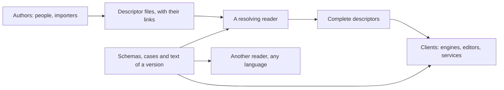
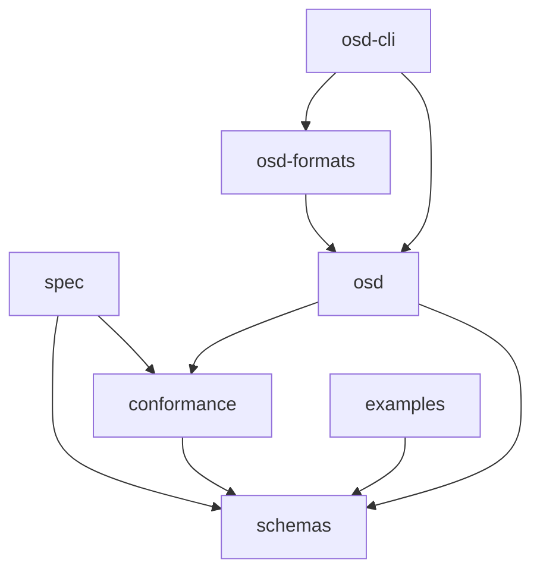

# Open Synth Descriptors — architecture

OSD is a format that describes music devices, their sounds, their firmwares and how each is recognised. The product is a specification and a reference reader: a set of JSON schemas per version, the conformance cases that give each field its meaning, the text that explains both, and `osd`, a reader written in Rust. This document says how these parts are built and why.

## 1. Context

Four things cross the edge of the product:

- **a descriptor**, a JSON document that names its version by `$schema`;
- **the schemas of a version**, served at a permanent address;
- **the conformance suite**, which any reader runs to prove what it reads;
- **the reader**, as a Rust library and as the `osd` command.

The role of the specification and what it refuses are in `docs/CADRE.md`. What a descriptor, a reader and a converter must do is in `spec/<version>.md`.

## 2. Strategy

1. **A version is a set of schemas and cases that never changes.** The schema states the shape of a descriptor. The conformance cases state what a reader returns. The text of the version explains both and yields to them. A change of the format is a new version, with a converter from the version before; a correction is a patch version. Until 1.0, a version adds and renames only through its converter. Reason: whoever adopts a version knows what will not move, and two readers written apart agree on what a descriptor means.
2. **Structure lives in JSON structures, and what runs is declared.** An encoding, a checksum or an address parameter is a structure that the schema checks. A descriptor that needs a script declares the capability. Reason: a tool reads a descriptor with a JSON Schema validator alone, and a reader that runs no code knows, when it loads a descriptor, what it cannot do.
3. **The identity of the format is a permanent address.** From version 0.5, each schema is identified by `https://w3id.org/osd/<version>/<kind>.schema.json`, an identifier that the W3C Permanent Identifier Community Group keeps and redirects to where the schemas are served. The format is listed in the SchemaStore catalogue, so a code editor completes a descriptor. Reason: the identity depends on no host, person or domain, and moving the hosting changes the redirect alone.
4. **Inheritance is for authors; a client is served the complete descriptor.** An author writes a device once and lets it take the profile of its maker and the MIDI of another device. A resolving reader follows these links and produces the complete descriptor, which holds no link. A client reads that descriptor alone. Reason: whoever looks for how a device speaks needs nothing of how the catalogue is built.

Version 1.0 is published when three independent readers hold the format: osc-bridge, SyntHub, and a complete round trip with the format of a partner.

The rules these choices rest on are `docs/CADRE.md` R1, R6, R8, R9 and R11, `spec/ERRATA.md`, and section 2 of `spec/<version>.md`.

## 3. Components

| Part | Responsibility | Owns | Language |
|---|---|---|---|
| `schemas/<version>/` | the shape of each kind of descriptor: device, maker profile, sound, fingerprint, firmware, assembly | the published JSON schemas | |
| `spec/` | the text of each version, the vocabulary of roles, and how a published version is corrected | the prose of the format | |
| `conformance/` | the meaning: for each case, what a reader returns; how a reader runs the suite; the version of the suite | the cases and their expected results | |
| `examples/` | one readable example of each kind of descriptor | the example files | |
| `osd` (`osd/`) | read a descriptor strictly, resolve its links, produce the complete descriptor, convert between versions | the Rust types of the format | cargo |
| `osd-formats` (`osd-formats/`) | translate between OSD and the formats others already use, and say what each translation loses | one importer and one exporter per format | cargo |
| `osd-cli` (`osd-cli/`) | the `osd` command, for a person or a tool that works on descriptor files | the words of the command and its exit codes | cargo |
| `osd-reference` (`reference/`) | build the reference of a version from its schemas: one page per kind, each property with its type and its description; count what is described | the pages of the reference and the count of described properties | cargo |

Each Rust part states its role in its `docs/CADRE.md` and what it exports in its `docs/INTERFACE.md`.

## 4. Data

| Data | Shape | Made by | Read by |
|---|---|---|---|
| descriptor | a JSON document that names its version; it may link to a maker profile and to another device | an author | a reader |
| complete descriptor | a descriptor of the same version, without links | a resolving reader | a client |
| conformance case | a folder: the input descriptors, and the result or the fault expected | the authors of the specification | every reader |

## 5. Flow

**A publisher serves a device.** A resolving reader reads the descriptor of the device, asks its source of files for each descriptor it links to, merges them by the rules of the version, and writes the complete descriptor. The publisher serves that descriptor, and a client reads it with a reader of the first level.

**Another reader proves that it conforms.** Its author wraps it in a program that takes one case and writes one result. A runner plays each case of the suite through that program, compares, and reports the version of the format and the version of the suite.

## 6. Runtime

`osd` performs no input or output: its caller supplies the files. It therefore runs natively, in a browser (WebAssembly) and on a server alike. `osd-formats` writes the text of another format and never runs the tool that reads it.

## 7. Cross-cutting concepts

- **Versions**: each descriptor names its version; a reader states the versions it reads, and a converter carries an older descriptor forward. The reader's version carries, in its first two numbers, the newest version of the format it reads.
- **Faults**: every refusal is a fault with its kind, the file, and the address of the faulty place in the file.
- **Credit**: a descriptor names where each of its parts comes from, with its licence.

## 8. Quality

- **Conformance**: a reader conforms when it passes the suite; a claim names the version of the format, the class of the reader and the version of the suite.
- **Permanence**: each file of a published version has a recorded checksum, so that anyone verifies that a version has not moved.
- **Cost**: reading and resolving a device takes a time in proportion to the size of its files; the budget is `osd/docs/CADRE.md` R16.

## 9. Risks

- **Old identifiers depend on one host.** Versions 0.1 to 0.4 are identified by addresses on the SyntHub site, and a published version never changes. A move of that site breaks them; version 0.5 and later are free of it.
- **The text is prose that no machine checks.** It can drift from the schemas and the cases. The text yields to them, and a difference is a defect of the text, corrected by a patch version.
